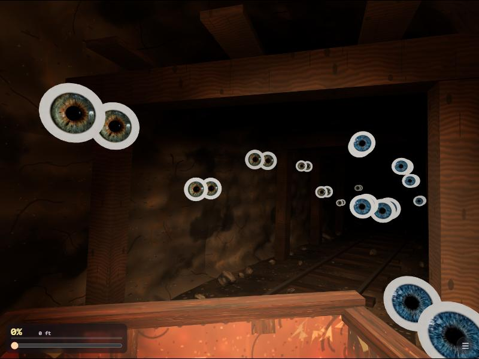
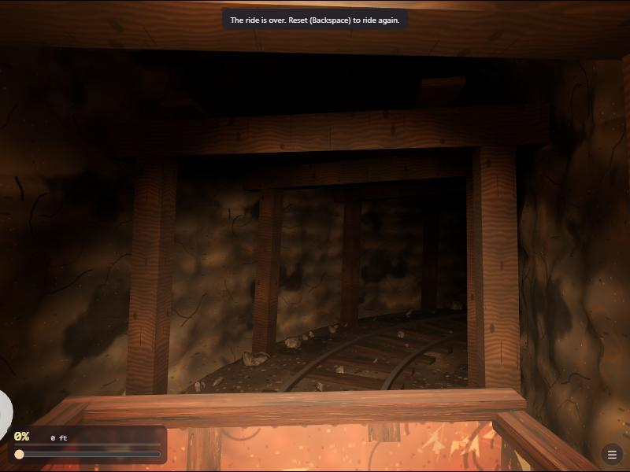

# CT72.A5.Eyes — context file

**Series:** CT72 Eyes · **Version:** A5 · **Date:** 2026-11-19 · **Built from:** `CT72.A4.Eyes` (copied; A1-A4 unchanged; read `CT72.A4.Eyes/CT72.A4.Eyes.md` for A4 (the timber fix, the steady eyes, the frame-rate work, the corner) and from there A3, A2, A1 and `CT61.B6.Darkride.md`) · **Art project** (Harness 7).
Open issues and questions: [ISSUES.html](ISSUES.html). To pick this project up in a later chat, point it at this file.

© 2026 Michael Wahrman. All rights reserved.

## Requests (A5, 2026-11-19)
> 1. Please use Sonnet
> 2. Please review CT72.A4.Eyes.md
> 3. Dust can default off, I dont see it.
> 4. The track should be visible even in the dark part
> 5. Mine car can be visible, maybe an option, default to visible
> 6. Not necessary to fade to black

## What A5 changed
1. **Sonnet:** this session runs on Sonnet 5.5.
3. **Dust starts off** (`?dust=1` or **U** turns it on).
4. **The track is visible in the dark part.** The light that follows the rails ahead is 2.7 times stronger (80, was 30), reaches 12 m (was 9) and is wider (cone 0.7, was 0.55), and a small warm light now sits just ahead of the camera. The rails, sleepers and the tunnel near you show through the corner to the stop (picture 1). The darkness is less black than in A4 (ISSUES 1).
5. **The mine car shows, by default.** A1-A4 hid every car. Now all five cars on the track are drawn, yours included: from your seat the rim and inside of your car show at the bottom of the picture, and the cars ahead of you on the track. **Car** button, key **C**, `?car=0` to start without (the V key looks from behind and above, where the whole car shows). Your seat is 10 cm lower (1.45 m, was 1.55) so the rim is in the picture; at 1.35 the car filled the bottom third and hid the rails. The small light by the camera lights the car so it is not a black shape; it goes off when the car is hidden or Lights is on.
6. **No fade to black.** The ride simply stops, where it did before, with the rails lit (picture 2). `?fade=1` brings the A4 fade back. The corner stays. The eyes in the dark now run to the end of the last straight (28 pairs, was 26), so there are eyes close ahead where the ride stops.

## Checked (2026-11-19, the Claude app's built-in Chromium, localhost, `?sound=0`)
- `node --check` on every changed script; no console errors.
- The ride stepped to the end: it stops at 37.5 m with no fade (the sheet's opacity is 0); all 28 pairs open and steady.
- Defaults: dust off, car shown, fade off. **C** hides and shows all five cars; the Car button exists.
- Pictures from the page: the dark corner with the track and car (1), the end (2).
- **Not checked:** the frame rate on a real running page (A4's note), a movie, the sound, MIDI hardware (the Car button has no built-in MIDI assignment: right-click it and press a control to learn one), a phone.

## Liberties taken (please check)
- **Seat 10 cm lower**, a car light, a stronger track light: my choices to make "visible" mean visible. The dark is lighter than A4's.
- **Eyes extended to the end of the last straight** (28 pairs).
- **Fade kept as an option** (`?fade=1`), not deleted.

## Files
As A4's, renamed `CT72.A5.Eyes_*.js`. Changed: `CT72.A5.Eyes_main.js` (Car, dust and fade defaults, the car light, the stronger track light) · `CT72.A5.Eyes_cars.js` (seat height) · `rooms/dark.js` (eyes to the end) · `index.html` (Car button and help row). URL options: as A4's plus `?car=0`, `?dust=1`, `?fade=1`.

