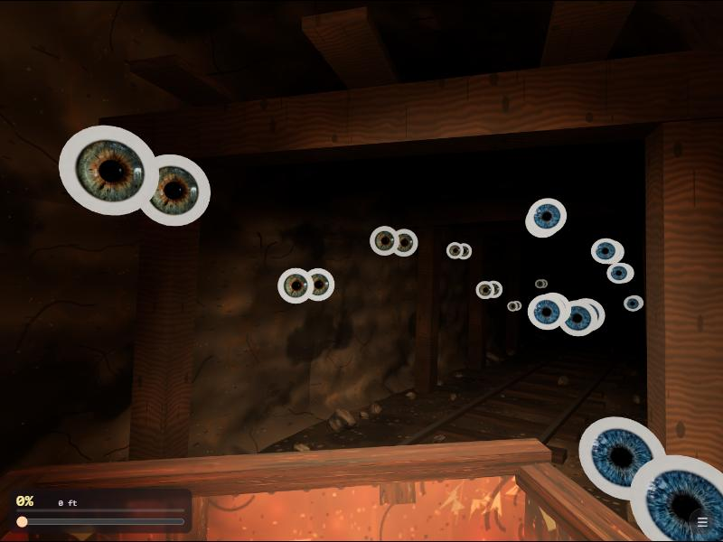

# CT72.A5 · Eyes

The room of eyes from the CT61 dark ride, on its own (three.js / WebGL, MIDI, buttons, keys, movie recorder). Art project.

You ride a mine car down a short tunnel into a rock chamber where giant eyeballs hang from the roof on cords and hundreds of small eyes cover the floor like a living rug. The big eyes and a third of the small ones turn to follow you as you pass. Then out of the far side into the dark, where pairs of eyes open in the walls and watch you, steadily, the rails still lit; you go round a corner and the ride stops. Press Reset (Backspace) to ride again.

Open `index.html` in Chrome or Edge. **H** shows the display on the right, **C** shows / hides the mine car, **U** dust, **L** turns the lights on, **O** switches shadows, **R** records a movie, **?** shows the help. [CT72.A5.Eyes.md](CT72.A5.Eyes.md) has the details; [ISSUES.md](ISSUES.md) the open issues and questions.

© 2026 Michael Wahrman. All rights reserved.
